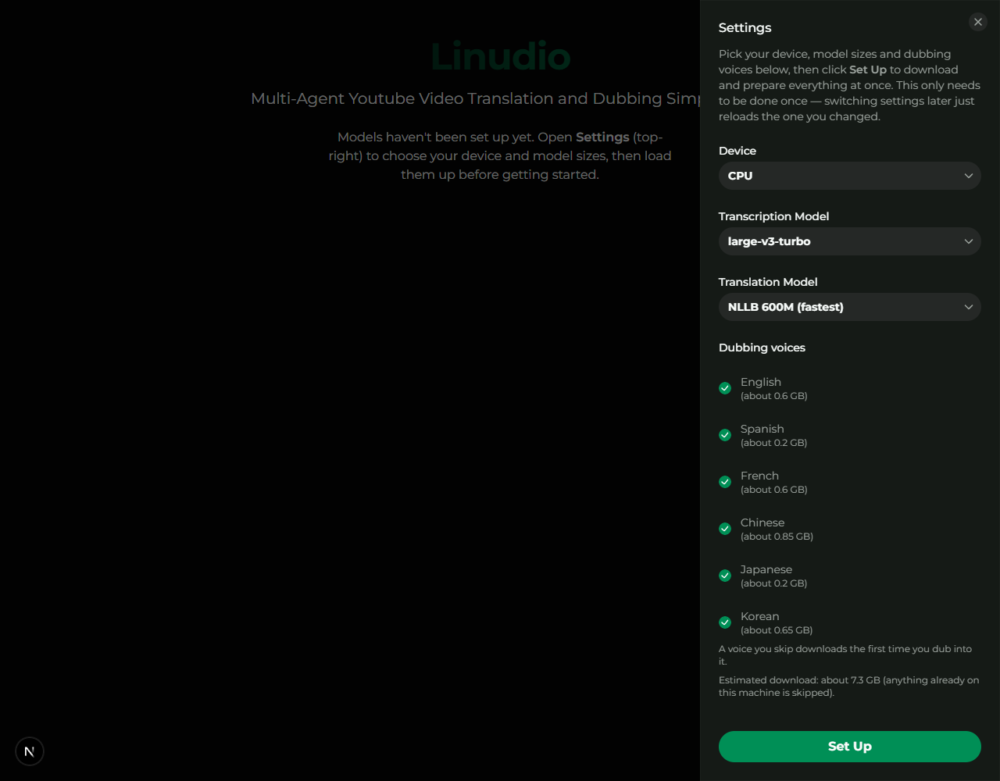

# Linudio

**Self-hosted YouTube video translation and dubbing, powered by AI models that run on your own machine.**

Paste a YouTube link. Linudio downloads the video, transcribes the speech, translates it, speaks the
translation in a new voice, and mixes it back over the original background audio to give you a
dubbed video. No cloud APIs, no accounts, no per-minute fees. It is built for ordinary CPU-only
computers; a GPU is optional.

> **Project status:** a personal project that has grown up. It works end to end, but expect rough
> edges. See [Limitations](#limitations).

```text
YouTube URL -> download (yt-dlp) -> transcribe (Whisper) -> translate (NLLB)
            -> speak (MeloTTS) -> separate background music -> mix + mux (FFmpeg) -> dubbed .mp4
```

## Features

- Transcription with [faster-whisper](https://github.com/SYSTRAN/faster-whisper), with automatic source-language detection
- Translation with Meta's NLLB-200 into English, Spanish, French, Japanese, Korean or Chinese
- Edit the transcript and the translation by hand before dubbing
- Download the transcript or translation as **.srt** subtitles or plain **.txt**, even if you never dub
- Speech with [MeloTTS](https://github.com/myshell-ai/MeloTTS), each line timed to the original
- Voice and background are separated, so music and effects stay in the dubbed video
- Pick your device (CPU, GPU, or auto) and model sizes in the app, with live download progress
- Everything runs locally and your videos never leave your computer

The first time you open the app you choose your device, model sizes and dubbing voices in the
settings panel, and one click on **Set Up** downloads and prepares everything, with progress shown.



## What you need

| Requirement | Notes |
| --- | --- |
| Python **3.11** | Tested on 3.11. |
| Node.js 20 or newer | For the web UI (tested on 22). Also satisfies the JavaScript runtime yt-dlp needs. |
| [FFmpeg](https://ffmpeg.org/download.html) | `ffmpeg` and `ffprobe` must be on your `PATH`. |
| [Git](https://git-scm.com/) | The installer fetches MeloTTS from GitHub. |
| Deno **or** Node.js | yt-dlp uses one to solve YouTube's player challenges. If you have Node.js you already have this. |
| Disk space | About 9 GB with the defaults: roughly 4 GB of Python packages (including a 0.8 GB Japanese dictionary) plus about 5 GB of models. Bigger models need more; see [Models and disk space](#models-and-disk-space). |
| RAM | 8 GB is comfortable with the defaults. Larger models need more. |

It is developed and tested on Windows 11. Linux and macOS should work (the CI workflow installs and
tests the backend on Linux) but have not been tried by hand.

## Quick start

**1. Get the code and set up the backend**

```bash
git clone https://github.com/hellbuster45/Audio-Processor.git
cd Audio-Processor/backend

python -m venv venv
venv\Scripts\activate            # Windows
# source venv/bin/activate       # Linux / macOS

python install.py                # add --gpu for an NVIDIA GPU
```

`install.py` installs PyTorch first and then everything else in the order it has to go, downloads
the Japanese dictionary and English language data that MeloTTS needs, and finishes by checking for
anything missing (FFmpeg, a JavaScript runtime). It takes a while: the downloads are several GB.
Do not use a bare `pip install -r requirements.txt`: two of the libraries declare conflicting
version ranges, which the script works around.

**Shortcut (Windows):** once `install.py` has finished, double-click `Linudio.bat` in the project
folder. It stops anything left over from a previous run, starts the backend and frontend together
(`npm run dev` at the top level does the same, without the browser handling), opens
<http://localhost:3000>, and shuts everything down when you close the browser tab. The first run
installs the Node packages for you. Then skip to step 5. The manual steps follow.

**2. Start the backend**

```bash
uvicorn main:app
```

It listens on <http://localhost:8000> and starts in a couple of seconds. No models are loaded yet.

**3. Start the frontend** (in a second terminal)

```bash
cd Audio-Processor/frontend
npm install
npm run dev
```

**4. Open <http://localhost:3000>** and click the gear icon in the top-right corner.

**5. Set up.** Choose a device, the model sizes and the dubbing voices you want, then click **Set Up**.
Everything is downloaded and prepared in one go (the models, the voice-separation model, language
data and the voices), with a step counter and progress bar. It can take a while, but when it
finishes nothing else will download, so your first dub runs straight through. You only do this once;
later changes to a setting reload just that one model.

**6. Dub a video.** Click **Get Started**, paste a YouTube URL, and follow the steps: fetch the
video, transcribe it, pick a target language and translate it, edit anything you want to fix, then
click **Start Dubbing**. When it finishes you can watch and download the result.

## Models and disk space

Everything downloads into `models/` at the top of the project, and nothing is stored anywhere
else. Delete the folder to get the space back.

| Step | Choice | Download |
| --- | --- | --- |
| Transcription | `tiny` | 0.08 GB |
| | `small` | 0.5 GB |
| | `medium` | 1.5 GB |
| | `large-v3-turbo` (default) | 1.6 GB |
| | `large-v3` | 3.1 GB |
| Translation | NLLB 600M (default) | 2.5 GB |
| | NLLB 1.3B | 5.5 GB |
| | NLLB 3.3B | 17.6 GB |
| Voice separation | Kim_Vocal_2 | 0.07 GB |
| Dubbing voice | English | 0.6 GB |
| | Spanish | 0.2 GB |
| | French | 0.6 GB |
| | Chinese | 0.85 GB |
| | Japanese | 0.2 GB |
| | Korean | 0.65 GB |

All six voices together are about 3.1 GB. The setup panel lets you untick the ones you don't need and
shows the estimated total. A voice you skip is simply downloaded the first time you dub into it.

Bigger models are more accurate and slower. On a CPU-only machine the defaults are a good place
to start.

## Languages

- **Spoken language of the video (transcription):** whatever Whisper can detect, which is about 99
  languages.
- **Translation and dubbing:** English, Spanish, French, Japanese, Korean and Chinese (Simplified).
  These are the languages MeloTTS can speak, so they are the ones the app offers.
- **Korean needs an extra tokenizer.** The installer tries to add it. On Windows it has to be
  compiled and needs the [Microsoft C++ Build Tools](https://visualstudio.microsoft.com/visual-cpp-build-tools/);
  if it can't be installed, everything else still works and the app tells you Korean dubbing is unavailable.

## Configuration

Settings live in `backend/.env`; copy `backend/.env.example` to start. Everything is optional.

| Setting | Default | What it does |
| --- | --- | --- |
| `STORAGE_DIR` | `backend/storage` | Where videos, generated audio and the database are kept |
| `DATABASE_URL` | SQLite file in `STORAGE_DIR` | Use [PostgreSQL](backend/postgres/README.md) instead if you prefer |
| `CORS_ORIGINS` | `http://localhost:3000,http://127.0.0.1:3000` | Where the web UI is allowed to call the API from |
| `DEVICE` | `cpu` | Pre-selected device: `cpu`, `cuda` or `auto` |
| `WHISPER_MODEL` | `large-v3-turbo` | Pre-selected transcription model |
| `NLLB_MODEL` | `facebook/nllb-200-distilled-600M` | Pre-selected translation model |
| `STT_BATCH_SIZE` | `1` | Leave at 1. Higher values use much more RAM and were less accurate in testing |

The frontend reads `NEXT_PUBLIC_API_URL` (default `http://localhost:8000`); see
`frontend/.env.example`. If you run the UI on another port, add it to `CORS_ORIGINS`.

### Using an NVIDIA GPU

Run `python install.py --gpu`, then pick **GPU (CUDA)** or **Auto** in the settings panel. faster-whisper
also needs the CUDA libraries (cuBLAS and cuDNN); see its documentation. GPU support is built but the
author has not tested it on real GPU hardware.

### YouTube cookies (only if you need them)

Some videos (age-restricted ones, or ones that ask you to "confirm you're not a bot") only download
when you are signed in. To allow that, export your YouTube cookies in Netscape format to
`backend/storage/cookies.txt`; see
[yt-dlp's FAQ](https://github.com/yt-dlp/yt-dlp/wiki/FAQ#how-do-i-pass-cookies-to-yt-dlp) for how. If
the file exists it is used automatically. It is a copy of your login session, so keep it private;
it is in `.gitignore` and must never be committed or shared.

### Resetting

Delete `backend/storage/` to remove all downloaded videos and the database. Delete `models/` to remove
the downloaded models.

## Troubleshooting

| Problem | What to try |
| --- | --- |
| A "tools weren't found" notice appears on the home page | Follow the hint shown for each item, then reload the page. FFmpeg and a JavaScript runtime must be on your `PATH`. |
| A dub fails after "Separating vocals" | Look at the terminal running the backend; the cause is printed there. The notice above also flags the usual culprits (missing dictionary or language data). |
| "Sign in to confirm you're not a bot" when fetching a video | Add a `cookies.txt` (see above). |
| The UI says it can't reach the backend | Is `uvicorn main:app` running in `backend/`? Browser errors mentioning CORS mean the UI's address isn't in `CORS_ORIGINS`. |
| Setup seems stuck | Large downloads take a while to begin. Watch the step counter and progress bar, or the backend's terminal. If you refresh the page mid-setup it picks the run back up. |
| Port 8000 or 3000 is already in use | Start the backend with `uvicorn main:app --port 8001` and set `NEXT_PUBLIC_API_URL` to match. |
| A fetch fails after a long time working | yt-dlp breaks when YouTube changes. Run `pip install -U yt-dlp` inside the virtual environment. |

## Limitations

- **For one person on one machine.** There are no accounts or login. The server only listens on
  `localhost` by default; **do not expose it to the internet.**
- **One dub at a time.** The speech step handles one job at a time.
- **YouTube only**, and only as far as yt-dlp can reach. Playlists are not supported.
- **One voice.** The dub uses a single voice per language; it does not copy the original speakers.
- **Timing is approximate.** Spoken lines are sped up or slowed down to fit the original timing, within limits.
- **Very long videos.** The final mix passes every line to FFmpeg at once, and on Windows that
  command can hit the operating system's length limit on videos with hundreds of lines.
- **Dubbing uses CPU by default**, so a long video can take a long time on a modest machine.

## How it is built

- **Backend:** Python, FastAPI, SQLAlchemy (SQLite by default). The backend is in `backend/`.
- **Frontend:** Next.js 16, React 19, TypeScript, HeroUI. The frontend is in `frontend/`.
- **Models:** faster-whisper, NLLB-200, MeloTTS, and an ONNX voice-separation model via audio-separator.
- **Media:** yt-dlp and FFmpeg.

The API documents itself at <http://localhost:8000/docs> while the backend is running. The main
endpoints are:

| Endpoint | Does |
| --- | --- |
| `POST /videos/yt_video` | Reads a YouTube URL's details and starts the download |
| `POST /synthesize/` | Transcribes a downloaded video |
| `POST /translate/` | Translates a transcript |
| `POST /text_to_speech/dub` | Starts a dubbing job |
| `GET /text_to_speech/dub_status` | Reports a dubbing job's progress |
| `GET /settings/device`, `/settings/status`, `/settings/preflight` | Current setup, load progress, and missing system tools |
| `POST /settings/setup` | First-time model setup (device plus both model sizes) |

## Development

```bash
# backend (inside the virtual environment, in backend/)
pip install -r requirements-dev.txt
pytest

# frontend (in frontend/)
npm run lint
npx tsc --noEmit
npm run build
```

CI runs all of this on every push; see `.github/workflows/ci.yml`.

## License

Linudio is a small personal project and has no license file, so all rights are reserved by default.
If you'd like to use or build on it, open an issue and ask.

**The AI models have their own licenses, and one matters a lot:** the NLLB translation models are
**CC-BY-NC-4.0, which forbids commercial use.** Full details for every model and library are in
[`THIRD_PARTY_NOTICES.md`](THIRD_PARTY_NOTICES.md).

Only use Linudio on videos you own or have permission to process. Downloading and re-publishing
other people's videos can break YouTube's Terms of Service and copyright law.

## Acknowledgements

Linudio stands on the work of [faster-whisper](https://github.com/SYSTRAN/faster-whisper),
[OpenAI Whisper](https://github.com/openai/whisper), [NLLB-200](https://github.com/facebookresearch/fairseq/tree/nllb),
[MeloTTS](https://github.com/myshell-ai/MeloTTS), [audio-separator](https://github.com/nomadkaraoke/python-audio-separator),
[yt-dlp](https://github.com/yt-dlp/yt-dlp), [FFmpeg](https://ffmpeg.org/), [Hugging Face Transformers](https://github.com/huggingface/transformers),
[PyTorch](https://pytorch.org/), [FastAPI](https://fastapi.tiangolo.com/) and [Next.js](https://nextjs.org/).
